<div align="center">

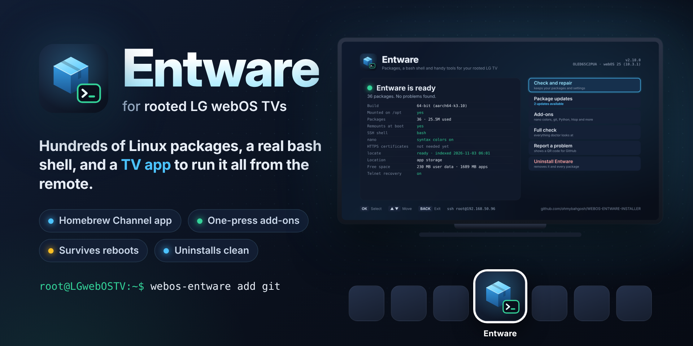

# WEBOS-ENTWARE-INSTALLER

**Entware for rooted LG webOS TVs, from the remote or one line over SSH.  Checks your TV first, picks the right build, survives reboots and uninstalls cleanly.**

[](https://github.com/ohmybahgosh/WEBOS-ENTWARE-INSTALLER/actions/workflows/ci.yml)
[](https://github.com/ohmybahgosh/WEBOS-ENTWARE-INSTALLER/releases/latest)
[](#supported-tvs)
[](#the-tv-app)
[](webos-entware-installer.sh)
[](LICENSE)
[](https://ohmybahgosh.dev/webos-entware-installer/)

</div>

Sets up **Entware** on **rooted LG webOS TVs**, so you can install hundreds of Linux command line packages with `opkg`, and gives you a bash shell, handy webOS commands and one-press [add-ons](#add-ons) like git, Python and htop.  Run it from the **[TV app](#the-tv-app)** with your remote, or over SSH.  Either way it's one POSIX shell script with no dependencies.

> [!IMPORTANT]
> **This changes a rooted TV, so read what it does first.**  It installs into `/mnt/lg/user/opt`, adds one Homebrew Channel boot script and, unless you use `--no-shell`, swaps in its own shell files after backing yours up.  Everything it adds is listed in [What it changes on the TV](#what-it-changes-on-the-tv), and `webos-entware uninstall` takes it all back out.  Keep **telnet** on in the Homebrew Channel as a way back in.  Provided as-is, with no warranty.

> [!NOTE]
> **How this is built.**  I, [OhMyBahGosh](https://github.com/ohmybahgosh), wrote the first versions by hand.  From v2.0 on, it's written with AI coding agents (Claude), directed, reviewed and tested by me.  I've been building software for over 17 years.  My day job is data engineering, and network security and pentesting are what I do for fun.  AI writes a lot of the code here; I decide what it does, check how it does it, and nothing ships until it's run on a real TV (an LG C2 on webOS 25).
>
> Many of the fixes that mattered came from that real-TV testing: a 2025 install the old version left half-working, `luna-send` answering nothing when called from a script, webOS having no group for `locate`, and helpers that left processes running.  The [changelog](CHANGELOG.md) has the full story.
>
> - **Tests on every push:** 160+ [tests](tests/run_tests.sh) install, repair, reboot, add and remove add-ons and uninstall in a private mount namespace with fake TV paths, under busybox `sh` (the TV's shell) and dash.  CI also runs ShellCheck, lints the app as ES5 for older TVs, builds the IPK and [checks what's in it](tests/check-ipk.sh), [drives the app with the remote's keys](tests/ui-test.js) in a headless browser, lints the workflows, and runs CodeQL.  Every action is pinned to a commit.  The CI badge above shows the latest run.
> - **Hard to break the TV:** a failed install undoes itself, your own shell files are backed up and put back, logins only switch to bash if it runs, and system partitions are never touched.  [SECURITY.md](SECURITY.md) lists everything it does as root.
>
> Commits list me as the author and Claude as the committer.  Found a problem?  See [SECURITY.md](SECURITY.md) or open an issue.

**Found a bug or have an idea?**  [Open an issue](https://github.com/ohmybahgosh/WEBOS-ENTWARE-INSTALLER/issues/new/choose), or use the [templates on ohmybahgosh.dev](https://ohmybahgosh.dev/contact/?t=ent-bug).

## Quick start

**With the remote:** in the Homebrew Channel, open Settings, add the repository `https://ohmybahgosh.dev/repo`, install **Entware**, open it and choose **Install Entware**.  [More about the app](#the-tv-app).

**Over SSH:**

```sh
wget -O /tmp/webos-entware-installer.sh https://raw.githubusercontent.com/ohmybahgosh/WEBOS-ENTWARE-INSTALLER/main/webos-entware-installer.sh
sh /tmp/webos-entware-installer.sh install
```

Then log in again for the bash shell, and try `ent search htop` or `webos-entware add git`.  [Full install guide](#install).

---

## Contents

- [Quick start](#quick-start)
- [The TV app](#the-tv-app)
- [Features](#features)
- [Supported TVs](#supported-tvs)
- [Requirements](#requirements)
- [Install](#install)
- [The build check (32-bit or 64-bit)](#the-build-check-32-bit-or-64-bit)
- [Options](#options)
- [After installing](#after-installing)
- [Managing the install](#managing-the-install)
- [The ent helper](#the-ent-helper)
- [Shell setup and shortcuts](#shell-setup-and-shortcuts)
- [webOS helpers](#webos-helpers)
- [nano](#nano)
- [HTTPS certificates](#https-certificates)
- [locate (mlocate)](#locate-mlocate)
- [Add-ons](#add-ons)
- [Where Entware lives](#where-entware-lives)
- [What it changes on the TV](#what-it-changes-on-the-tv)
  - [Upgrading from an older setup](#upgrading-from-an-older-setup)
- [Reboots](#reboots)
- [Uninstall](#uninstall)
- [Troubleshooting and recovery](#troubleshooting-and-recovery)
- [FAQ](#faq)
- [Contributing](#contributing)
- [Credits](#credits)

---

## The TV app

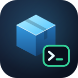

The easiest way in.  It runs the same installer underneath, as root through the Homebrew Channel, so you don't need SSH to install or manage Entware.

- **Status at a glance:** whether Entware is installed and mounted, the build, packages and disk use, the boot script, the SSH shell, nano, HTTPS certificates, locate, free space and telnet recovery, plus any problems found.
- **Install Entware**, or **Repair** when something's wrong.  It uses the recommended build for your TV and keeps your packages and settings on a repair.
- **Add-ons:** nano with syntax colors, locate, HTTPS certificates, git, Python, htop, tmux, ncdu, rsync, curl and jq, each with the setup it needs on webOS.  One press adds, finishes setting up or removes one.
- **Update packages** and **Uninstall Entware**, with a confirmation before anything is removed.
- **Live progress:** every task runs in the background on the TV and its log shows as it goes.  Closing the app doesn't stop it, and reopening the app picks the progress back up.
- **Full check:** everything `doctor` looks at, on screen.
- **Report a problem:** a QR code that opens a bug report on your phone with your TV, version, build and the full check already filled in.
- **Updates itself:** when a new version is out, **Update to v…** downloads it from GitHub, checks it against the release's checksums and that it really is this app, installs it and reopens.  The `webos-entware` command updates with it.  The Homebrew Channel offers updates too.
- **Made for the remote:** arrow keys and OK, or point and click with the Magic Remote.  BACK closes whatever is open.

<p align="center">
  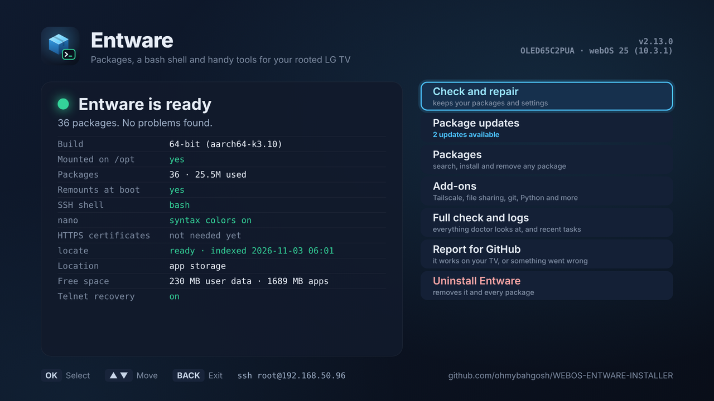
  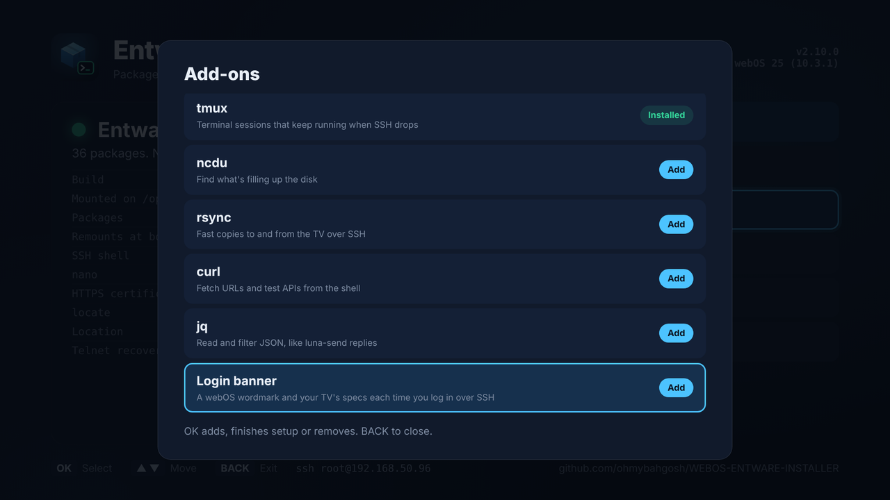
</p>

**Install it from the Homebrew Channel:** open the Homebrew Channel, go to Settings, add the repository `https://ohmybahgosh.dev/repo`, then install **Entware** from the list.  The Homebrew Channel then offers updates like for any other app.

**Or install the IPK yourself:** download `org.ohmybahgosh.entware_*.ipk` from the [latest release](https://github.com/ohmybahgosh/WEBOS-ENTWARE-INSTALLER/releases/latest) and install it with `ares-install`, or on the TV:

```sh
luna-send -n 1 luna://com.webos.appInstallService/dev/install '{"id":"org.ohmybahgosh.entware","ipkUrl":"/tmp/org.ohmybahgosh.entware_2.8.0_all.ipk"}'
```

Already installed Entware over SSH?  Open the app and it shows your install as it is.  The app and the `webos-entware` command run the same installer, and a repair from the app updates the saved command to the app's version.  Removing the app leaves Entware installed; use **Uninstall Entware** first if you want it gone too.

---

## Features

- ✅ **A TV app** for the Homebrew Channel: install, repair, add-ons, updates and uninstall from the remote, with live progress.
- ✅ **One-press add-ons** (nano colors, locate, git, Python, htop, tmux and more), each set up for webOS.
- ✅ **Checks the TV before touching anything**: root, model, webOS version, kernel, Homebrew Channel, free space and the Entware download server.
- ✅ **Picks the right Entware build**: recommends 64-bit (`aarch64`) or 32-bit (`armv7`) from your kernel, tells you why, and asks you to continue, switch or exit.
- ✅ **Test-runs the build first**. If the 64-bit build can't run, it falls back to 32-bit.
- ✅ **Never leaves a half install**. If a fresh install fails partway, everything it did is undone. A failed repair keeps your existing install and packages.
- ✅ **Checks the result** when it finishes and prints a summary.
- ✅ **Survives reboots** with a Homebrew Channel boot script that remounts `/opt` and starts Entware services, plus a backup remount at SSH login if the boot script didn't run.
- ✅ **`doctor` check** that shows what's installed and says exactly what to fix.
- ✅ **`ent` helper** for searching, installing and checking packages, with Tab completion for `ent`, `opkg` and package names. `opkg` itself is never replaced.
- ✅ **Saves itself as `webos-entware`**, so status, repair and uninstall work any time, even after a reboot wipes `/tmp`.
- ✅ **Optional bash shell** with nano, colors, a neon prompt and handy aliases, plus a safe fallback to the stock shell if bash is ever missing or broken.
- ✅ **Backs up your own `.profile` and `.bashrc`** and puts them back on uninstall. Your edits to the installer's `.bashrc` survive a repair.
- ✅ **Fixes "I have no name!"** by linking Entware to the system user files.
- ✅ **webOS helpers** (`toast`, `launch`, `close`, `apps`, `applog`, `tvshot`) for scripting the TV from SSH.
- ✅ **One task at a time:** the app and SSH can never change things at once.
- ✅ **Clean uninstall** that removes everything it added.

---

## Supported TVs

- **webOS 23, 24 and 25** (webOS 8, 9 and 10 internally) are the main targets.
- **webOS 22 and older** (webOS 4 and up) should work too. The installer tells you when your version is outside the tested range.
- Both **64-bit and 32-bit kernels** are supported. Most recent OLEDs (C2, C3, G4, C4 and up) have a 64-bit kernel. Many budget and older models have a 32-bit one.

---

## Requirements

- A **rooted** LG webOS TV with the **Homebrew Channel** installed. See [webosbrew.org/rooting](https://www.webosbrew.org/pages/rooting/) and check your firmware at [cani.rootmy.tv](https://cani.rootmy.tv).
- **SSH** turned on in Homebrew Channel settings. Keeping **telnet** on too gives you a way back in if SSH ever breaks.
- An **internet connection** on the TV.
- About **50 MB** free space.

Without the Homebrew Channel, Entware still installs, but there's no boot script. With the shell setup, `/opt` comes back when you log in over SSH. With `--no-shell`, run install again after each reboot. The installer warns you and asks first.

---

## Install

SSH into your TV as root, then download and run the installer:

```sh
wget -O /tmp/webos-entware-installer.sh https://raw.githubusercontent.com/ohmybahgosh/WEBOS-ENTWARE-INSTALLER/main/webos-entware-installer.sh
sh /tmp/webos-entware-installer.sh
```

Pick **1) Install or repair Entware**. The installer shows your TV details and the build it recommends, then asks you to confirm.

When it finishes, **disconnect and SSH in again** to get the bash shell.

<p align="center">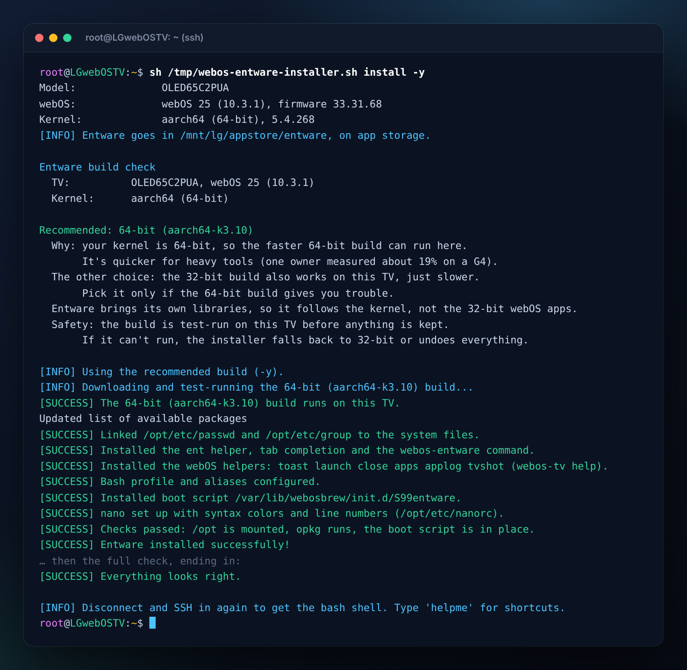</p>

### Skip the menu

```sh
sh /tmp/webos-entware-installer.sh install      # install, or repair an existing install
sh /tmp/webos-entware-installer.sh doctor       # check the TV and the install
sh /tmp/webos-entware-installer.sh uninstall    # remove everything
```

### One line, piped into sh

```sh
wget -O - https://raw.githubusercontent.com/ohmybahgosh/WEBOS-ENTWARE-INSTALLER/main/webos-entware-installer.sh | sh -s -- install
```

It still asks its questions in your SSH session. Add `-y` at the end to skip them and take the recommended build. With no terminal at all (for example from a script), it refuses to guess and asks for `-y` or `--arch`.

---

## The build check (32-bit or 64-bit)

Before it changes anything, the installer shows what it found and what it recommends:

```
Entware build check
  TV:          OLED65C2PUA, webOS 24 (9.2.1)
  Kernel:      aarch64 (64-bit)
  webOS apps:  32-bit (normal, every LG TV ships them this way)

Recommended: 64-bit (aarch64-k3.10)
  Why: your kernel is 64-bit, so the faster 64-bit build can run here.
       It's quicker for heavy tools (one owner measured about 19% on a G4).
  The other choice: the 32-bit build also works on this TV, just slower.
       Pick it only if the 64-bit build gives you trouble.
  Entware brings its own libraries, so it follows the kernel, not the 32-bit webOS apps.
  Safety: the build is test-run on this TV before anything is kept.
       If it can't run, the installer falls back to 32-bit or undoes everything.

[C]ontinue with 64-bit, [S]witch to 32-bit, or [E]xit:
```

On a TV with a 32-bit kernel it recommends the 32-bit build, explains that this is normal on many LG TVs, and offers only Continue or Exit, since the 64-bit build can't run there.

---

## Options

| Option | What it does |
|:-------|:-------------|
| `-y`, `--yes` | Skip the questions and use the recommended build |
| `--arch=aarch64-k3.10` | Use the 64-bit build without asking |
| `--arch=armv7sf-k3.2` | Use the 32-bit build without asking |
| `--no-shell` | Install Entware only. Your `.profile`, `.bashrc` and login shell are left alone |
| `--with-locate` | Also set up locate |
| `--location=user` | Put a new install on user data instead of app storage (the default).  See [Where Entware lives](#where-entware-lives) |
| `--json` | With `status` or `job-status`: print JSON |
| `-h`, `--help` | Show the commands and options |

---

## After installing

- SSH in again to get bash. Type `helpme` for the shortcuts.
- Try `ent search htop`, then `ent install htop`.
- Run `webos-entware doctor` any time to check everything.

---

## Managing the install

After the first install, the installer is saved on the TV as the `webos-entware` command:

| Command | What it does |
|:--------|:-------------|
| `webos-entware doctor` | Check the TV and the install, and say what to fix (same as `status`) |
| `webos-entware install` | Repair or update the install. Your packages are kept |
| `webos-entware uninstall` | Remove Entware and everything the installer added |
| `webos-entware upgrade` | Refresh the package list and upgrade every package (same as `ent upgrade`) |
| `webos-entware locate` | Set up locate (see [locate](#locate-mlocate)) |
| `webos-entware addons` | List the [add-ons](#add-ons) and whether each is installed |
| `webos-entware add <name>` | Install an add-on with its webOS setup, e.g. `add git` |
| `webos-entware remove <name>` | Uninstall an add-on |
| `webos-entware status --json` | Everything `doctor` checks, as JSON for scripts |
| `webos-entware app-update` | Update the TV app (and this command) to the newest release, checked against its checksums |
| `webos-entware move appstore` | Move Entware to app storage, or `move user` to user data.  A repair also moves older installs to app storage.  See [Where Entware lives](#where-entware-lives) |
| `webos-entware job <task>` | Run `install`, `uninstall`, `locate`, `upgrade`, `add <name>`, `remove <name>` or `move <place>` in the background; `job-status` follows it |
| `webos-entware` | Open the menu |

`doctor` shows your model, webOS version, kernel, Homebrew Channel and telnet status, the installed and recommended builds, whether `/opt` is mounted, whether `opkg` and bash run, and whether the boot script and shell files are in place. It ends with "Everything looks right" or a list of problems, each with its fix.

<p align="center">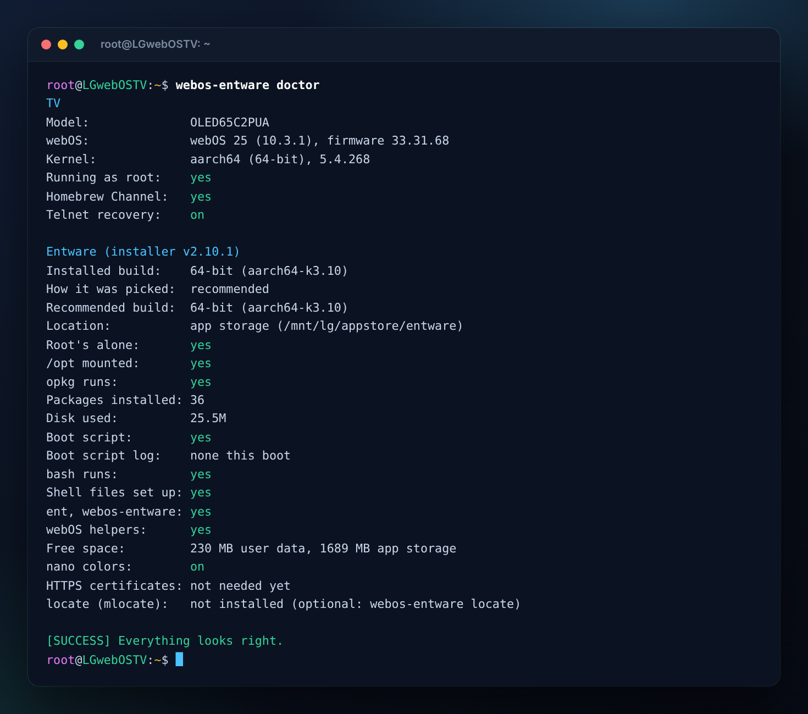</p>

The installer also writes `/opt/etc/webos-entware/install.info` with the installer version, date, model, webOS version, firmware, kernel and build. It's handy to paste into a bug report.

Install, repair, uninstall, locate and upgrade take a lock, so two of them can never run at once, from SSH or the TV app.  If one is running, the other says so and stops.  A lock left by a task that was stopped is cleared on its own.

If you piped the installer into sh, there's no file to copy, so it saves the published version from GitHub instead. If that download fails, it tells you, and you can download it to `/opt/bin/webos-entware` yourself.

---

## The ent helper

`ent` (also called `entwrap`) is a separate helper command. Plain `opkg` keeps working as normal.

| Command | What it does |
|:--------|:-------------|
| `ent search <text>` | Search available packages by name or description.  Each result shows its version, whether it's installed, and its description cut to fit the screen.  Name matches come first |
| `ent install <pkg>` | Install packages, plus the webOS setup some need (nano colors, HTTPS certificates, locate) |
| `ent remove <pkg>` | Remove packages |
| `ent info <pkg>` | Show package details |
| `ent files <pkg>` | List the files a package installed |
| `ent owns <file or command>` | Show which package a file or command came from, or that it's part of webOS |
| `ent du [count]` | Largest installed packages, Entware's total size and free space on the data partition |
| `ent list` | List installed packages |
| `ent update` | Refresh the package list |
| `ent upgradable` | Show packages with updates |
| `ent upgrade` | Refresh the list and upgrade everything |
| `ent repair` | Reinstall the Entware core |
| `ent doctor` | Same as `webos-entware doctor` |
| `ent help` | Show all `ent` commands |

Anything else is passed straight to `opkg`, so `ent list-installed` works too.

<p align="center">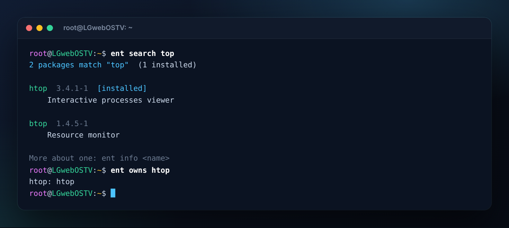</p>

**Tab completion** (in the bash shell): press Tab after `ent`, `opkg` or `webos-entware` to complete commands. After `install`, `info` or `search` it completes available package names. After `remove`, `files` or `upgrade` it completes installed ones.

---

## Shell setup and shortcuts

Unless you use `--no-shell`, the installer adds bash, nano-full, dircolors and GNU ls (`coreutils-ls`, which fits `ls -l` columns to their contents, unlike busybox ls), and sets SSH logins to switch to bash. If bash is ever missing or broken, logins stay on the stock shell instead of failing.

| Shortcut | What it does |
|:---------|:-------------|
| `helpme` | List the shortcuts |
| `ls`, `ll`, `la`, `lt`, `l` | Colored file listings |
| `..`, `...` | Go up one or two folders |
| `myip`, `netinfo` | Network addresses and routes |
| `dfh`, `up` | Disk space and uptime |
| `edit <file>` | Open a file in nano |
| `findf <text>` | Find files by name, with highlighting |
| `entup`, `entlist`, `entfix` | `ent update`, `ent list`, `ent repair` |
| `tr0 <file>` | Empty a file |
| `reboot_safe` | Reboot after a short delay |

The aliases and prompt live in `/opt/etc/webos-entware/bashrc`, so they go away with Entware.

---

## webOS helpers

Small commands for working with the TV from SSH. They use webOS's own services through `luna-send`, so they need nothing extra installed.

| Command | What it does |
|:--------|:-------------|
| `toast <message>` | Show a notification on the TV screen, e.g. at the end of a script or cron job |
| `launch <app-id> [json]` | Start an app, with optional launch parameters: `launch netflix` |
| `close <app-id>` | Close an app |
| `apps [-a] [text]` | List apps with their IDs and types; `*` marks running ones. `-a` includes hidden apps, and text filters the list |
| `applog [app-id or text]` | Follow the system log (`/var/log/messages`), optionally only lines that mention an app |
| `tvshot [file]` | Save a screenshot of the screen (PNG, or JPG if the name ends in `.jpg`; default in `/tmp`) and print the `scp` command to copy it. Streaming apps show black, since protected video can't be captured |

Tab after `launch`, `close` or `applog` completes app IDs. `webos-tv help` lists the commands, and each one also works as `webos-tv <command>`. If a package already installed a command with one of these names, the installer leaves it alone and you can use `webos-tv <command>` instead.

<p align="center">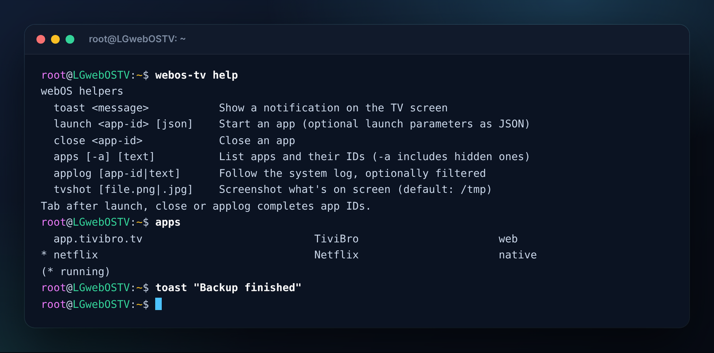</p>

`doctor` also shows the free space on the data partition, which webOS shares with Entware, and flags it below 50 MB.

---

## nano

nano-full ships syntax colors for over 130 languages, but its stock `/opt/etc/nanorc` has every line commented out, so nano starts plain. The installer writes a nanorc that turns on all of them, with line numbers, the cursor position on the status bar, and reopening files where you left off. Common extras (mouse, autoindent, tab size, soft wrap) are listed in the file, commented out.

It only replaces a stock nanorc or one it wrote itself (marked on its first line), so a nanorc you've edited is kept. Settings in your own `~/.nanorc` are read afterwards and win. Installing nano with `ent install nano-full` sets it up too.

<p align="center">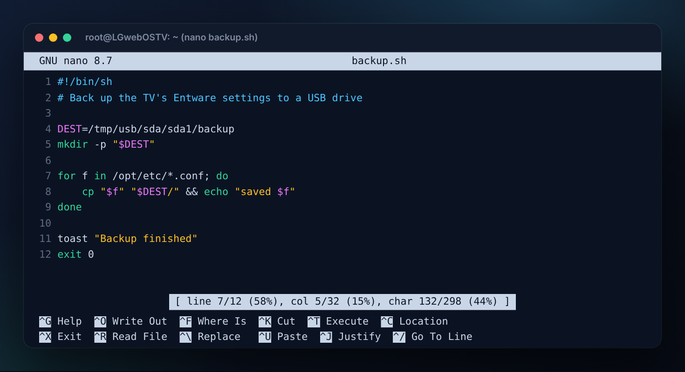</p>

---

## HTTPS certificates

Programs built on Entware's OpenSSL (`wget-ssl`, `git`, `openssl-util`) and Python check HTTPS sites against `/opt/etc/ssl/certs/ca-certificates.crt`, which only exists once `ca-bundle` is installed. `curl` and anything else built on libcurl pull it in themselves, but most others don't, so their HTTPS downloads fail with certificate errors.

Whenever OpenSSL or Python is installed, through `ent install` or found during a repair, the installer adds `ca-bundle`. `doctor` shows whether the certificates are there, and flags it when a program needs them and they're missing.

---

## locate (mlocate)

`locate` finds files by name instantly from a database. Entware's mlocate doesn't work on webOS out of the box: `updatedb` refuses to run because webOS has no `mlocate` group, and with no settings it would list most files several times, since webOS mounts the same storage at several paths. Set it up with any of these:

```sh
ent install mlocate          # installs it and sets it up
webos-entware add locate     # sets it up (installs mlocate if needed)
webos-entware locate         # the same
sh webos-entware-installer.sh install --with-locate
```

This adds:

| Path | What |
|:-----|:-----|
| `/opt/etc/updatedb.conf` | Excludes duplicate mount points (`/mnt/lg/cmn_data`, `/mnt/lg/flash`, `/mnt/lg/appstore`, `/mnt/lg/db8`, app jails in `/var/palm/jail`), virtual filesystems, `/tmp` (and so USB drives) and `.git` folders. Each file is indexed under one path |
| `/opt/bin/updatedb-webos` | Runs `updatedb` with an `mlocate` group that exists only inside a private mount namespace, so no system file is changed. In the bash shell, `updatedb` is an alias for it |
| `/opt/etc/cron.hourly/updatedb` | Refreshes the database every hour, using Entware's `cron` (installed if needed and started by the boot script) |

A full refresh takes a couple of seconds. Repairing Entware sets locate up again if mlocate is installed. It rewrites `updatedb.conf` only while the file still has the installer's first line, so delete that line to keep your own settings. Scripts should call `updatedb-webos`, since the `updatedb` alias only exists in the interactive shell. `doctor` shows whether locate is ready and how old the database is.

<p align="center">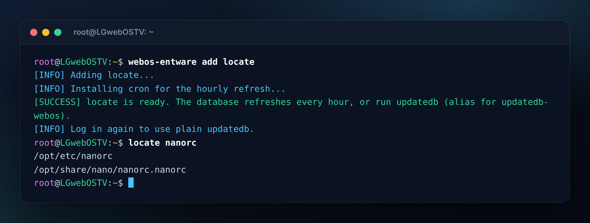</p>

---

## Add-ons

Packages worth one press, with the setup each needs on webOS.  Install them from the TV app's **Add-ons** screen, or over SSH:

```sh
webos-entware addons         # what's available and what's installed
webos-entware add git        # install one
webos-entware remove git     # and take it off again
```

| Add-on | Packages | What you get |
|:-------|:---------|:-------------|
| `nano` | nano-full | [Syntax colors](#nano) for 130+ languages and line numbers.  Part of the shell setup, so it stays |
| `locate` | mlocate | [locate](#locate-mlocate) with settings for webOS and an hourly refresh.  Removing it takes the settings and the hourly job too |
| `certs` | ca-bundle | [HTTPS certificates](#https-certificates).  Stays, since other packages rely on it |
| `git` | git, git-http | git with HTTPS, and the certificates it needs |
| `python` | python3, python3-pip | Python 3 with pip, and the certificates it needs.  The largest add-on |
| `htop` | htop | A live view of CPU and memory use |
| `tmux` | tmux | Terminal sessions that keep running when SSH drops |
| `ncdu` | ncdu | Find what's filling up the disk |
| `rsync` | rsync | Fast copies to and from the TV over SSH |
| `curl` | curl | Fetch URLs and test APIs |
| `jq` | jq | Read and filter JSON, like `luna-send` replies |

Any other Entware package installs with `ent install <package>` as usual.  The list is fixed in the installer, so the app can only ever ask for one of these by name.

<p align="center">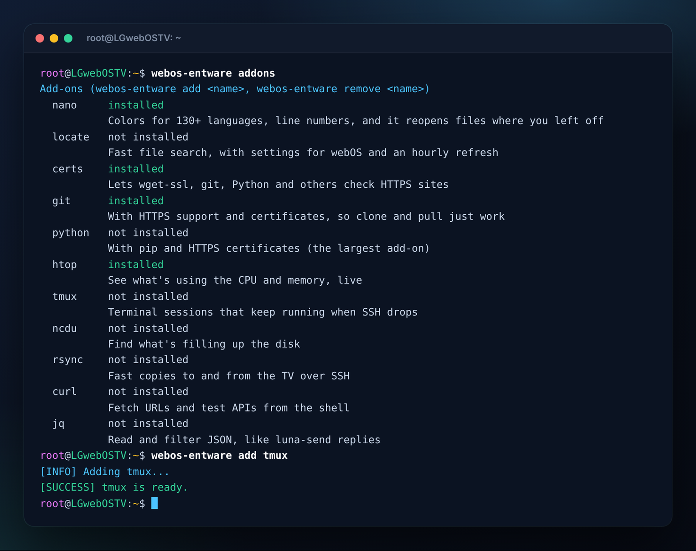</p>

---

## Where Entware lives

LG TVs have two storage areas that Entware can use:

| | App storage (the default) | User data |
|:--|:--|:--|
| Folder | `/mnt/lg/appstore/entware` | `/mnt/lg/user/opt` |
| Size on a C2 | about 2.7 GB | about 720 MB |
| Shared with | installed apps | webOS's own settings, caches and databases |
| Firmware update | kept | kept |
| "Reset to initial settings" | kept | **deleted** |
| Factory reset | deleted | deleted |

New installs go on **app storage** when the TV has it and it has more room than user data, which is the case on every recent LG TV.  Otherwise they go on user data, where versions before 2.9 always put Entware.  User data is small, and webOS needs some of it for itself.  App storage has much more room and survives "Reset to initial settings".

**Older installs move over on their next repair.**  Running install (or **Repair** in the TV app) on an Entware that's on user data moves it to app storage, with the same checked move as `webos-entware move appstore`.  Over SSH it asks first.  Say no and it stays on user data, and repairs won't ask again.  If the move can't happen right then (another program is using Entware, or there's no room), Entware stays where it is, working, the repair still succeeds, and the next repair tries again.

```sh
sh webos-entware-installer.sh install --location=user    # a new install on user data instead
webos-entware move appstore                               # move an existing install to app storage
webos-entware move user                                   # or back to user data, and keep it there
```

A move stops Entware's services and checks no other program is using Entware.  Then it copies everything into a fresh folder, checks the copy matches, switches `/opt` over and checks it's that very copy, updates the boot script and your login, and only then removes the old copy.  If anything fails before the switch, Entware stays where it was.  It took 28 seconds for 25 MB on a C2.  `doctor` and the TV app show where Entware is and the free space in each area.

Until it moves, Entware points this out: the TV app shows a notice and a **Move to app storage** button, and SSH logins, the `webos-entware` menu and `doctor` say how to move it.  Installs from before 2.9 get these once the TV app updates from the Homebrew Channel, or with their next repair, which moves them anyway.

Choosing a place with `--location` or `move` sticks: repairs won't move it again, and the notices stop.  `webos-entware move user` on an install that's already on user data keeps it there for good.

Entware goes in a new root-only folder at the top of app storage, not `/media/developer` or `/media/internal`: other apps can write to those, and Entware's programs run as root.

**Only Entware that's root's alone is used.**  `/mnt/lg/user` can be written by any user on webOS, so a process that isn't root could otherwise swap in a folder of its own for the boot script to run as root.  So the boot script, the SSH login and the installer mount Entware first and then check `/opt` itself, where it can no longer be swapped: the folder and everything on the way to what runs as root (`bin`, `sbin`, `etc`, `etc/init.d`, `lib`, `opkg`, `rc.unslung`) must be real folders and files, owned by root, that no one else can write to.  Anything else is unmounted unused, and a login won't put it on your PATH or start its bash.  `doctor` shows this as "Root's alone" and names anything that fails.  Deleting an old copy (after a move, or on uninstall) goes through a private mount, after checking it's the very folder meant.

---

## What it changes on the TV

| Path | What |
|:-----|:-----|
| `/mnt/lg/appstore/entware` | Entware, all packages, and the `ent` and `webos-entware` commands.  `/mnt/lg/user/opt` instead when it's on [user data](#where-entware-lives) |
| `/opt` | Bind mount of the folder above. On webOS 25 the stock `/opt` only holds LG's factory test programs (`/opt/webos/tests`), which are hidden while Entware is mounted. Nothing on the TV needs them |
| `/var/lib/webosbrew/init.d/S99entware` | Boot script that remounts `/opt` and starts Entware services |
| `/home/root/.profile` | Switches interactive SSH logins to bash, and remounts `/opt` if the boot script didn't (skipped with `--no-shell`) |
| `/home/root/.bash_profile` | Loads `.profile` and `.bashrc` in bash |
| `/home/root/.bashrc` | Loads the aliases and prompt. Add your own settings here: repairing keeps this file |

Your own `.profile`, `.bash_profile` and `.bashrc` are saved with a `.pre-entware` suffix before they are replaced. Your old `.profile` and `.bashrc` still run from the new files. A repair keeps the installer's `.bashrc` as it is, edits included, and if it ever has to rewrite `.profile` or `.bash_profile` after you changed them, it saves your copy as `.bak` first (then `.bak.1`, `.bak.2` and so on, so an older backup is never overwritten). Uninstalling saves an edited `.bashrc` as `.bashrc.entware-saved`.

If a fresh install fails partway, your shell files are put back exactly as they were, and the backups it made are removed.

Apart from the leftovers described in [Upgrading from an older setup](#upgrading-from-an-older-setup), nothing else on the system is touched.

### Upgrading from an older setup

Run install. It finds an Entware folder left by an older version of this script (or by an early manual setup), keeps your packages, and repairs everything around it:

- Moves Entware from user data to app storage, which has more room (see [Where Entware lives](#where-entware-lives))
- Puts the real `opkg` back where older versions had replaced it with a wrapper
- Replaces the old shell files. Your old `.bashrc` is saved as `.bashrc.bak`. One-line settings you added to it yourself (`alias`, `export`, `NAME=value`) are moved to the end of the new `.bashrc`, so they still work and still win over the defaults. Anything else, like lines inside a function, is listed on screen for you to copy over yourself.
- Writes the boot script, and turns off any older boot script that also mounts Entware on `/opt`. It is renamed with an `.entware-old` suffix, so it stops running but you can still read it.
- Removes Entware package lists from webOS's own opkg folders (`/var/lib/opkg/lists/entware` and Entware's lists in `/var/cache/opkg`). These are left when Entware's opkg runs before `/opt` is set up. webOS doesn't use them, and lists from other feeds are left alone.
- Removes an old boot log (`/mnt/lg/user/entware_boot.log`) and an empty `/mnt/lg/user/lib/opkg` folder from early setups

The cleanup only runs once the install has passed its checks. `doctor` lists any of these leftovers, plus old copies of installer scripts in your home folder that you may want to delete.

Your `nanorc` and other settings in `/opt/etc` are kept. Links in your home folder that point into Entware, like `~/.nanorc -> /opt/etc/nanorc`, keep working, and uninstall removes them.

---

## Reboots

The Homebrew Channel runs the scripts in `/var/lib/webosbrew/init.d` at every boot. The installer's `S99entware` script remounts `/opt` and starts any Entware services in `/opt/etc/init.d`. It runs in the background, so it never holds up the boot, and gives up quietly if Entware has been removed.

Each boot it notes what it did in `/tmp/webos-entware-boot.log`, and `doctor` shows the last line. If `doctor` says there is no boot log, the boot script never ran, which means the Homebrew Channel didn't run its boot scripts at that boot.

As a backup, your SSH login also mounts `/opt` if the boot script didn't, so Entware and bash are there as soon as you log in. `doctor` tells you when that happened. Services in `/opt/etc/init.d` then start at login instead of at boot.

> **Upgrading from a version before 2.1?** Those versions didn't write a boot script, so `/opt` was gone after every reboot. Run install once with the current version to add it.

---

## Uninstall

```sh
webos-entware uninstall
```

(or `sh /tmp/webos-entware-installer.sh uninstall` if you still have the downloaded copy)

This asks first, then removes Entware, every package installed with it, the boot script and the shell files the installer wrote, links in your home folder that point into Entware, and unmounts `/opt`. Your original shell files are put back. Disconnect and SSH in again afterwards.

If `/opt` can't be unmounted, or something (like a USB drive) is still mounted inside `/mnt/lg/user/opt`, the folder is kept rather than deleted. Fix that and run uninstall again.

To reinstall later, just run the install again.

---

## Troubleshooting and recovery

**Start here:** `webos-entware doctor` lists each problem with its fix.

**SSH closes right after login, or bash misbehaves.** Get a plain shell that skips your login files:

```sh
ssh -t root@<tv-ip> sh       # plain shell over SSH
telnet <tv-ip>               # Homebrew Channel telnet, if it's on
```

From there, `rm /home/root/.profile` gets normal SSH back right away. Then run `webos-entware install` to repair, or `webos-entware uninstall`.

**Entware is gone after a reboot.** Run `sh /mnt/lg/user/opt/bin/webos-entware doctor` (the saved copy works even while `/opt` isn't mounted). If the boot script is missing, run install again. If it says the boot script didn't run, the Homebrew Channel skipped its boot scripts at that boot: open the Homebrew Channel app once and check again. If the problem keeps coming back, please open an issue with the `doctor` output.

**The TV crashed during boot.** On the next boot the Homebrew Channel starts in failsafe mode, skips boot scripts and opens telnet. Connect with telnet, remove `/var/lib/webosbrew/init.d/S99entware`, then reboot.

**The install stopped with an error.** A fresh install undoes itself, so the TV is as it was. Fix what the message says (often the internet connection) and run install again.

**"No terminal to answer on."** The installer couldn't ask its questions. Run it from an SSH session, or add `-y` or `--arch=...`.

**Installed with an older version of this script?** Run install again. It keeps your packages and cleans up after the old version. See [Upgrading from an older setup](#upgrading-from-an-older-setup).

---

## FAQ

**Why 32-bit or 64-bit?** Every LG TV runs a 32-bit system, but Entware brings its own libraries, so only the kernel matters. A 64-bit kernel can run the faster `aarch64` build. A 32-bit kernel needs `armv7`. Both are normal, and both offer nearly the same packages.

**Where does it download from?** Only Entware's official server, using the same files as Entware's own `generic.sh` installer: `opkg` and `opkg.conf` from `http://bin.entware.net/aarch64-k3.10/installer/` (64-bit) or `http://bin.entware.net/armv7sf-k3.2/installer/` (32-bit). Packages then come from the feed that `opkg.conf` names. It's plain http because that's what Entware publishes.

**Does it change opkg?** No. `opkg` is Entware's own, untouched. `ent` is a separate helper.

**Can I keep my own shell?** Yes. Install with `--no-shell`. Entware programs are in `/opt/bin` and `/opt/sbin`. Without the shell setup there's no backup remount at login, so `/opt` depends on the boot script alone.

**How is it tested?** `tests/run_tests.sh` runs install, repair, reboots, add-ons and uninstall on a Linux PC as root, inside a private mount namespace with fake `wget` and `opkg`, under busybox sh and dash. It doesn't touch the PC or download anything. CI also builds the TV app, checks the IPK and clicks through the app in a headless browser. None of it can stand in for a real TV, so changes are tried on one (an LG C2 on webOS 25) before release.

**Does the app phone home?** No. It only talks to GitHub: it reads the latest release number to say when an update is out, and downloads that release when you choose **Update**. See [SECURITY.md](SECURITY.md).

---

## Important Reminders

- **Never overwrite** system partitions or the stock `/opt` folder manually.
- **Stay cautious** when installing packages that could affect system networking or shell behavior.
- **Keep telnet on** in Homebrew Channel settings as a backup way in.

---

## Contributing

Bug reports and ideas are welcome: use the [issue forms](https://github.com/ohmybahgosh/WEBOS-ENTWARE-INSTALLER/issues/new/choose).  For pull requests, run the tests first (`sudo tests/run_tests.sh` and `sudo tests/run_tests.sh dash`, which need root for their private mount namespace) and test on a real TV if you can, saying which model and webOS version.

AI-assisted pull requests are welcome too, held to the same standard as the rest of this project: say in the pull request that AI was used, make sure you understand and have reviewed every change, and test it on a real TV.

To build the TV app yourself: `npm install -g @webos-tools/cli`, then `webos-app/build.sh`.  The IPK and its Homebrew Channel manifest land in `webos-app/out/`.  `tests/check-ipk.sh` checks the build, and `node tests/ui-test.js` (with `npm install playwright`) clicks through the app and saves screenshots to `tests/ui-out/`.

---

## Credits

- Developed and maintained by [OhMyBahGosh](https://github.com/ohmybahgosh)
- Built on [Entware](https://github.com/Entware/Entware) and the [webOS Homebrew Channel](https://github.com/webosbrew/webos-homebrew-channel)
- The app's QR codes use [qrcode-generator](https://github.com/kazuhikoarase/qrcode-generator) by Kazuhiko Arase (MIT)
- Special thanks to the webOS homebrew and rooting community

---

## License

MIT License.  See [LICENSE](LICENSE).

---

<p align="center"><strong>⚡ Let's make WebOS better, one safe improvement at a time! ⚡</strong></p>
